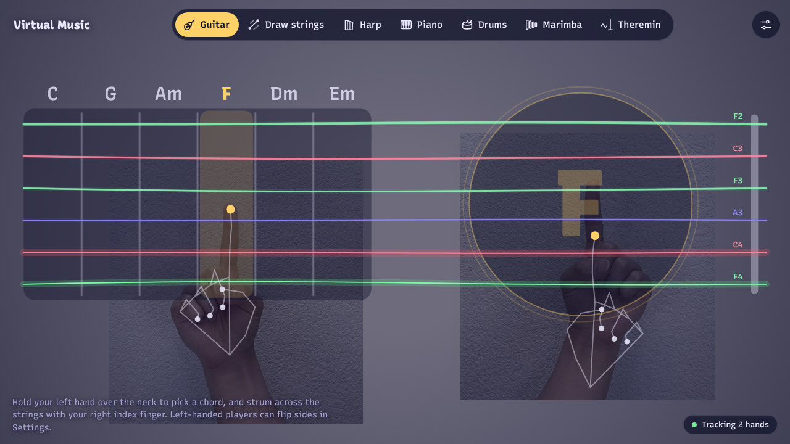
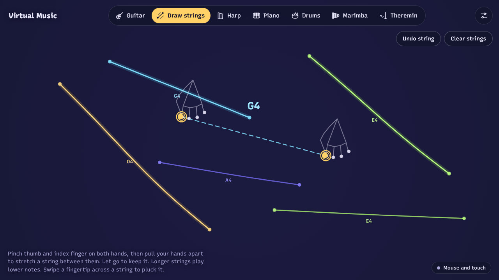
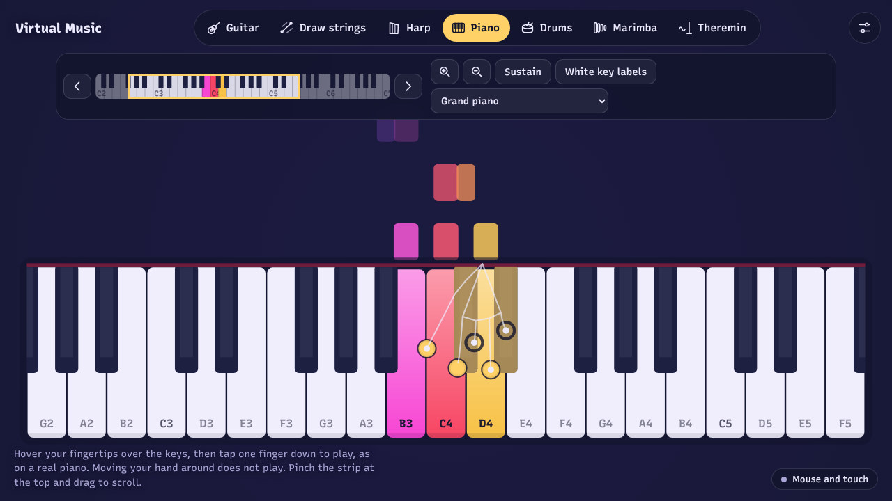
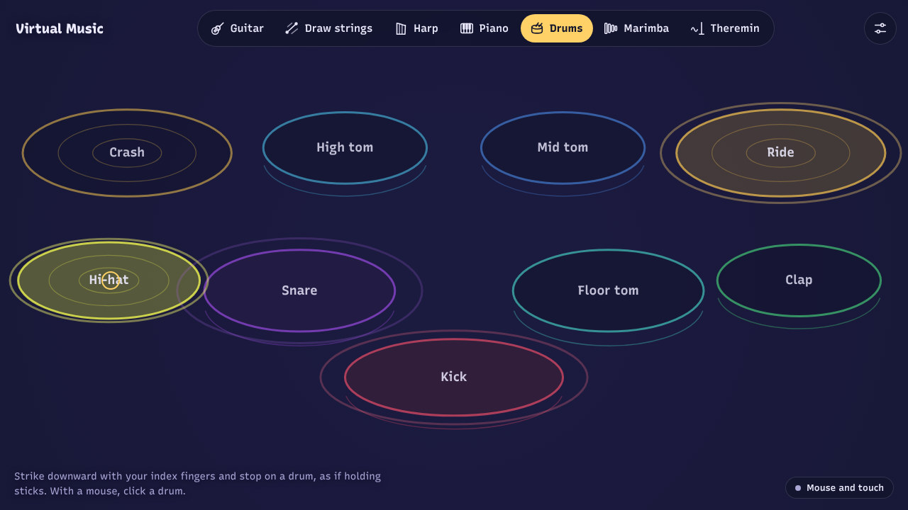
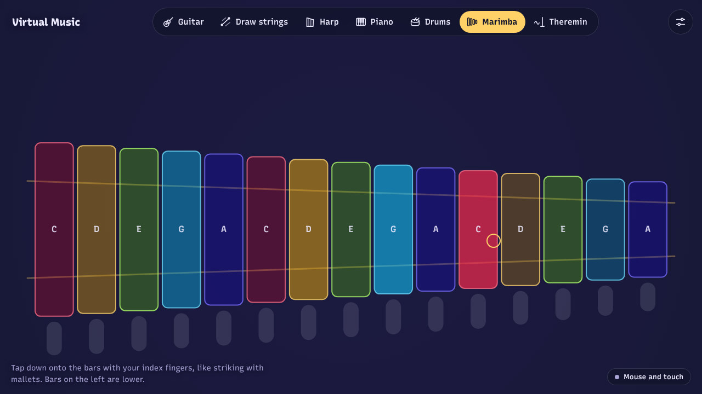
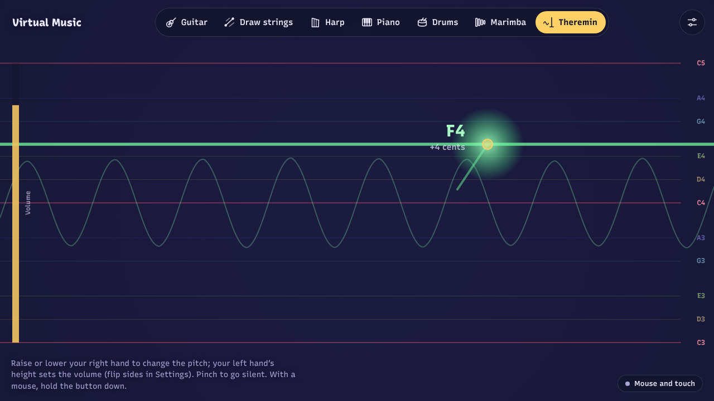
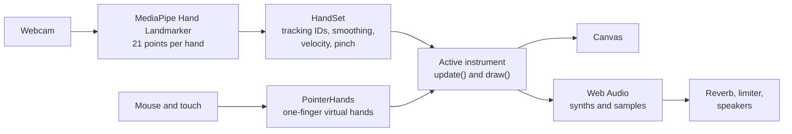

<div align="center">

# Virtual Music

**Play instruments in the air.**<br>
Your webcam tracks your hands. Guitar strings, piano keys and drums appear on screen, and you play them by moving your fingers.

[Live demo](https://khjabir.github.io/virtual-music/) · [Quick start](#quick-start) · [Instruments](#the-instruments) · [How it works](#how-it-works) · [Contributing](#contributing)

[](LICENSE)
[](#quick-start)
[](https://ai.google.dev/edge/mediapipe/solutions/vision/hand_landmarker)
[](https://developer.mozilla.org/docs/Web/API/Web_Audio_API)
[](#contributing)


</div>

## Why

Short videos of people strumming virtual strings with hand tracking keep going viral, and they all stop at the demo. Virtual Music turns the idea into a whole band you can actually play: seven instruments, each with a gesture designed for how that instrument is really played. You strum the guitar, pluck the harp, tap piano keys, strike the drums and wave at the theremin.

It all runs in a browser tab, with no install, no account and no server. Open the page, allow the camera, and play.

## Features

- **Seven instruments:** guitar, draw-your-own strings, harp, a full piano, drums, marimba and theremin.
- **Real hand tracking in the browser:** Google's MediaPipe follows 21 points on each of two hands, up to 30 times a second, on your own computer.
- **Gestures that feel like the real thing:**
  - The guitar has a chord neck and a strum zone, and the strings sound in the order you cross them.
  - Drums detect a stick-like strike.
  - The piano listens for individual finger taps, so moving your hand around never plays a note.
- **A proper piano:**
  - 61 keys by default (49, 76 or 88 in Settings), with zoom and scroll.
  - One keyboard or two stacked keyboards.
  - Key labels (C4, C or Do-Re-Mi), sustain pedal and note trails.
  - Recorded grand piano samples with two loudness levels, and 12 more sampled sounds.
- **Draw your own instrument:** pinch with both hands and pull to stretch a string anywhere. Its length sets its note, snapped to the key and scale you choose.
- **Every note has a colour,** the same on every instrument, so a C is always red and a G is always blue.
- **Hands-free controls:** hold a fingertip over any button for a second to press it.
- **Works without a camera:** play with the mouse, a touch screen (multi-touch), or the computer keyboard.
- **Private by design:** video never leaves your device, and nothing is uploaded or stored on a server.
- **Tiny and hackable:** about 4,000 lines of plain JavaScript modules, with no framework, no bundler and no dependencies to install. Adding an instrument means writing one file.

## Gallery

<table>
  <tr>
    <td width="50%"><br><b>Guitar.</b> Pick a chord with one hand, strum with the other.</td>
    <td width="50%"><br><b>Draw strings.</b> Pinch with both hands and pull. Length sets the note.</td>
  </tr>
  <tr>
    <td><br><b>Piano.</b> Tap a finger to press a key. Rings fill up as a finger goes down.</td>
    <td><br><b>Two keyboards,</b> each scrolling on its own, here with Do-Re-Mi labels.</td>
  </tr>
  <tr>
    <td><br><b>Harp.</b> Sweep across the strings, tuned to any scale.</td>
    <td><br><b>Drums.</b> Strike down and stop, as if holding sticks.</td>
  </tr>
  <tr>
    <td><br><b>Marimba,</b> also vibraphone, glockenspiel and steel drum.</td>
    <td><br><b>Theremin.</b> Hand height is pitch; the other hand is volume.</td>
  </tr>
</table>

## Quick start

**Try it online:** open the [live demo](https://khjabir.github.io/virtual-music/) in Chrome, Edge, Safari or Firefox and choose **Turn on camera**.

**Run it locally.** Browsers only allow the camera and JavaScript modules on a web server, so serve the folder instead of opening `index.html` directly:

```bash
git clone https://github.com/khjabir/virtual-music.git
cd virtual-music
python3 -m http.server 8000     # or: npm start
```

Then open **<http://localhost:8000>**.

You need:
- a webcam;
- a recent desktop browser (Chrome or Edge give the smoothest tracking);
- an internet connection the first time. The hand-tracking model is about 20 MB, the grand piano samples about 8 MB, and each other piano sound under 1 MB. After that your browser serves them from its cache.

No webcam? Choose **Play with mouse or touch** on the start screen.

### Put it online with GitHub Pages

The app is a static site, so there is nothing to build:

1. Push the repository to GitHub.
2. Open **Settings → Pages**, choose **Deploy from a branch**, then pick `main` and `/ (root)`.
3. After a minute it is live at `https://<your-username>.github.io/virtual-music/`. Pages uses HTTPS, which the camera requires.

## The instruments

| Key | Instrument | How to play |
| :-: | --- | --- |
| 1 | **Guitar** | Hold your left hand over the neck to pick one of six chords. Strum across the strings with your right index finger. Faster strums are louder, and a downstroke sounds the strings low to high. Four chord sets: pop, folk, rock and blues. Acoustic, nylon or overdriven electric. |
| 2 | **Draw strings** | Pinch thumb and index finger on **both** hands, then pull your hands apart to stretch a string between them. Let go to keep it. Longer strings play lower notes. Swipe across a string to pluck it. Pinching one hand never draws, so you can't draw by accident while playing. With a mouse, drag; on a touch screen, touch with two fingers. |
| 3 | **Harp** | 12 to 24 strings tuned to the current key and scale. Sweep your fingers sideways. |
| 4 | **Piano** | Hover your fingertips over the keys, then tap one finger down. See [the piano](#the-piano) below. |
| 5 | **Drums** | Kick, snare, hi-hat, three toms, crash, ride and clap. Strike downward with your index fingers and stop on a drum. Harder strokes are louder. |
| 6 | **Marimba** | Strike the bars like the drums. Marimba, vibraphone, glockenspiel or steel drum. |
| 7 | **Theremin** | Your right hand's height sets the pitch and your left hand's height sets the volume. Pinch to go silent. Glide freely or snap to the scale. |

The harp, drawn strings, marimba and theremin all follow the **Key** and **Scale** in Settings. The default is C major pentatonic, so nothing you play can sound wrong.

### The piano

**Playing with your hands.** Hold your hands over the keys as you would on a real piano: palms down, fingers relaxed. Then tap one finger down. A key plays only when a single finger moves down relative to its own knuckle. Moving your hands around, lowering them or tilting the whole hand plays nothing. Each fingertip over the keyboard shows a ring that fills as the finger goes down, and the key under it glows. Hold the finger down to hold the note, and faster taps play louder.

**Zoom and scroll.** The strip at the top shows the whole keyboard, with the part on screen outlined in gold.
- **Scroll:** drag the strip, pinch it with your hand and slide sideways, or use the arrow buttons, the arrow keys or the mouse wheel.
- **Zoom:** from 7 white keys to the whole keyboard, using the magnifier buttons, the + and − keys, or Ctrl plus the wheel (or a trackpad pinch).

For hand play, zoom so each key is about as wide as the gap between your fingertips. Your zoom and position are remembered.

**Layouts.** One keyboard, or two stacked keyboards that each scroll on their own and can each have their own sound, such as bass below and electric piano above.

**Labels.** Off, C keys only, white keys or all keys, shown as C4, C or Do-Re-Mi.

**Sounds:**
- **Recorded:** the Salamander grand piano at two loudness levels (soft notes sound softer, not just quieter), bright piano, electric piano, FM electric piano, harpsichord, music box, vibraphone, jazz organ, church organ, strings, choir, warm pad and nylon guitar.
- **Built-in:** piano, electric piano, organ and synth, which work offline. If a recorded sound can't download, its built-in match plays instead.

**Sustain.** The Sustain button holds notes after you lift your fingers, like the right pedal. You can also hold the Space bar.

**Other ways to play:**
- **Mouse or touch:** click or tap keys, slide along them, or use several fingers at once on a touch screen.
- **Computer keyboard:** A W S E D F T G Y H U J K O L P ; ' play from the first C on screen, and Z to M play the white keys an octave lower.

## Controls

| Action | How |
| --- | --- |
| Switch instrument | Keys **1** to **7**, click a tab, or hold a fingertip over a tab for a second |
| Open settings | **,** (comma) or the sliders button |
| Press any button hands-free | Hold your index fingertip over it until the gold ring fills |
| Draw strings: undo or clear | **Backspace** or **C** |
| Piano: play notes | **A W S E D F T G Y H U J K O L P ; '** (home row) and **Z X C V B N M** (an octave lower) |
| Piano: scroll and zoom | **← →** (hold **Shift** for an octave) and **+ −** |
| Piano: sustain pedal | Hold **Space** |

**Settings** are remembered in your browser. They include volume, reverb, key and scale, camera brightness, the hand outline, a **left-handed layout** that flips the guitar, drums and theremin, and options for each instrument.

### Tips for good tracking

- **Light your hands from the front.** A bright window behind you makes them hard to see.
- **Sit about an arm's length from the camera,** so each whole hand, including the wrist, stays in view.
- **A plain background helps.**
- **If tracking stutters on your computer,** add `?cpu` to the address (`http://localhost:8000/?cpu`) to skip the GPU.

## How it works



1. **Tracking.** Each video frame goes to MediaPipe's hand landmarker, which runs on the GPU in WebAssembly and WebGL. The 21 landmarks per hand are mirrored to match the selfie view and mapped onto the screen. A [One Euro filter](https://gery.casiez.net/1euro/) removes jitter when a hand is still but adds almost no lag to fast strums. Each hand keeps an ID between frames, so every fingertip knows where it was on the previous frame and how fast it is moving.
2. **Gestures.** Each kind of instrument has its own detector:
   - **Plucking** (guitar, harp, drawn strings): each fingertip remembers which side of each string it is on, and a pluck is the moment that side flips. A fast swipe can't skip a string, a small dead zone stops a resting finger from re-triggering, and in a strum the strings sound in the order you crossed them, a few milliseconds apart.
   - **Striking** (drums, marimba): a hit is a fast downward movement followed by a sudden stop, which is what a drumstick does. The speed of the stroke sets the loudness.
   - **Finger taps** (piano): each fingertip is measured against its own knuckle, as a fraction of hand size, so moving the hand or changing its distance from the camera changes nothing. Tilting the whole hand is cancelled by comparing each finger with the least-moved of the other fingers. Each finger slowly learns its resting position, so any comfortable pose works.
   - **Pinch** (drawing strings, grabbing the piano's scroll strip): the thumb and index tips come close, relative to hand size. A drawing pinch must be held briefly, and both hands must pinch.
3. **Sound.** Everything is generated live with the Web Audio API:
   - **Plucked strings:** [Karplus-Strong](https://en.wikipedia.org/wiki/Karplus%E2%80%93Strong_string_synthesis) synthesis, rendered once per note and cached.
   - **Drums:** synthesized in the style of analogue drum machines.
   - **Marimba family:** modal synthesis with each bar's real overtone ratios.
   - **Theremin:** a continuous voice with vibrato.
   - **Piano:** recorded samples streamed on demand. They are spaced three semitones apart, so none is pitch-shifted more than one semitone.

   Everything passes through a shared reverb and limiter.

### Project structure

```
virtual-music/
├── index.html                 page shell, start screen, settings panel
├── styles.css                 all styling
├── src/
│   ├── main.js                camera, main loop, UI wiring
│   ├── tracking/
│   │   ├── handTracker.js     MediaPipe wrapper (GPU with CPU fallback)
│   │   ├── hands.js           hand IDs, smoothing, velocity, pinch; mouse and touch hands
│   │   └── oneEuro.js         jitter filter
│   ├── audio/
│   │   ├── engine.js          audio context, reverb, limiter, channels
│   │   ├── synths.js          plucked strings, keyboard patches, drums, mallets, theremin
│   │   ├── sampler.js         streamed piano and keyboard samples
│   │   └── music.js           scales, chords, note names and colours
│   ├── instruments/
│   │   ├── base.js            the Instrument class every instrument extends
│   │   ├── common.js          vibrating strings, crossing and strike detectors
│   │   ├── guitar.js  stringCanvas.js  harp.js  piano.js
│   │   ├── drums.js  marimba.js  theremin.js
│   │   ├── piano/             keyboard rows, finger-tap detection
│   │   └── index.js           the instrument list (toolbar order)
│   └── ui/                    settings, hands-free buttons, hand overlay
└── docs/images/               screenshots and demo
```

## Add your own instrument

Create a file in `src/instruments/`, extend `Instrument`, and add it to the list in `src/instruments/index.js`. It appears in the toolbar with its own number key, and gets a settings section built from its `settings` list. Here is a complete instrument, a row of pads you strike:

```js
import { Instrument } from './base.js';
import { StrikeDetector } from './common.js';
import { mallet } from '../audio/synths.js';

export class Pads extends Instrument {
  static id = 'pads';
  static label = 'Pads';
  static icon = '<rect x="4" y="4" width="16" height="16" rx="3"/>'; // SVG for the toolbar
  static hint = 'Strike a pad.';
  static settings = [{ key: 'kind', label: 'Sound', type: 'select', options: [['marimba', 'Marimba']], default: 'marimba' }];

  strikes = new StrikeDetector();

  layout() {        // on resize and when settings change
    this.pads = [60, 64, 67].map((midi, i) => ({ midi, x: this.W * (0.2 + i * 0.25), y: this.H * 0.5, r: 80 }));
  }

  update(hands) {   // every frame, with every tracked hand
    const at = (p) => this.pads.find((pad) => Math.hypot(p.x - pad.x, p.y - pad.y) < pad.r);
    for (const hit of this.strikes.detect(hands, [8], this.H, at)) {
      mallet(this.engine, this.channel, hit.zone.midi, { velocity: hit.velocity, kind: this.opts.kind });
    }
  }

  draw(ctx) {       // every frame
    for (const p of this.pads) { ctx.beginPath(); ctx.arc(p.x, p.y, p.r, 0, Math.PI * 2); ctx.strokeStyle = '#FFD166'; ctx.stroke(); }
  }
}
```

Each hand gives you:
- `points`: the 21 screen positions (4 is the thumb tip, 8 the index tip);
- `prev`: the same points on the last frame;
- `vel`, `pinching`, `pinchPoint` and `extended`.

For plucking, `CrossingDetector` in `common.js` does the work.

## Browser support

| Browser | Status |
| --- | --- |
| Chrome and Edge (desktop) | Recommended. GPU hand tracking, lowest latency. |
| Safari 16.4+ and Firefox (desktop) | Supported. Tracking may fall back to the CPU and run slower. |
| Phones and tablets | Touch play works well. Camera play is possible but cramped. |

The camera needs a secure page: `localhost` or HTTPS.

## Privacy

The camera image is processed only inside your browser tab. It is never recorded, uploaded or sent anywhere. The only network requests are for the app's own files: the MediaPipe library and model, fonts, and the piano samples. Settings are saved in your browser's local storage.

## Troubleshooting

<details>
<summary><b>"Camera access is blocked"</b></summary>

Allow the camera for the site in your browser's address bar or site settings, then reload. On macOS, also check **System Settings → Privacy & Security → Camera** for your browser.
</details>

<details>
<summary><b>The page says it needs a local web server</b></summary>

You opened `index.html` straight from disk. Run `python3 -m http.server 8000` in the folder and open <http://localhost:8000>.
</details>

<details>
<summary><b>Hands aren't detected, or tracking is jumpy</b></summary>

Light your hands from the front, move back until your whole hand is in view, and avoid a bright window behind you. If it is still slow, try `?cpu` at the end of the address.
</details>

<details>
<summary><b>Piano taps don't register, or notes play by themselves</b></summary>

Adjust **Tap sensitivity** in Settings, and zoom so each key is about as wide as the gap between your fingertips. If your camera angle makes taps hard to see, switch **Press keys by** to *Lowering fingertips into the keys*.
</details>

<details>
<summary><b>No sound</b></summary>

Check the volume slider in Settings and your system volume. Browsers only start audio after a click, so make sure you chose one of the buttons on the start screen.
</details>

<details>
<summary><b>"Could not download" next to a piano sound</b></summary>

The samples come from jsDelivr. Check your connection, or pick one of the built-in sounds, which work offline.
</details>

## Roadmap

Ideas, roughly in order. Contributions are very welcome.

- [ ] Record and loop: layer a drum beat, chords and a melody
- [ ] MIDI output (Web MIDI), to play any synth or DAW with your hands
- [ ] Learn mode: falling notes for simple songs on the piano
- [ ] A short calibration step that tunes thresholds to your camera and hands
- [ ] More instruments: violin with a bow hand, DJ turntable, chord pad
- [ ] Jam with a friend over WebRTC
- [ ] Installable offline app (PWA) with cached samples

## Contributing

Bug reports, ideas and pull requests are welcome.

1. Fork the repository and run it locally (see [Quick start](#quick-start)). There is nothing to install or build. Edit a file and reload.
2. Use **Play with mouse or touch** to test an instrument without a camera, and `window.virtualMusic` in the browser console to inspect the running app.
3. Keep to plain ES modules with no dependencies, and keep each instrument in its own file.
4. Open a pull request describing what you changed and how you tested it. A short screen recording helps a lot for gesture changes.

When reporting tracking problems, please mention your browser, your camera and roughly how far you sit from it.

## License

[MIT](LICENSE) © 2026 khjabir

Third-party assets keep their own licenses. They are loaded at runtime and not included in this repository:
- **Hand tracking:** [MediaPipe Tasks Vision](https://www.npmjs.com/package/@mediapipe/tasks-vision) (Apache 2.0)
- **Grand piano samples:** [Salamander Grand Piano V3](https://archive.org/details/SalamanderGrandPianoV3) by Alexander Holm (CC BY 3.0), packaged as [@audio-samples/piano-mp3](https://github.com/darosh/samples-piano-mp3)
- **Other keyboard sounds:** the FluidR3 General MIDI sound font by Frank Wen (CC BY 3.0), via [gleitz/midi-js-soundfonts](https://github.com/gleitz/midi-js-soundfonts)
- **Typeface:** [Recursive](https://www.recursive.design/) (SIL Open Font License)

## Acknowledgements

- The many hand-tracked air-instrument videos that inspired this project.
- Google's MediaPipe team, for hand tracking that runs in a browser tab.
- Kevin Karplus and Alex Strong, whose 1983 plucked-string algorithm still makes every guitar and harp string here.
- Géry Casiez, Nicolas Roussel and Daniel Vogel, for the One Euro filter.

<div align="center"><sub>Made with two hands and no instruments.</sub></div>
