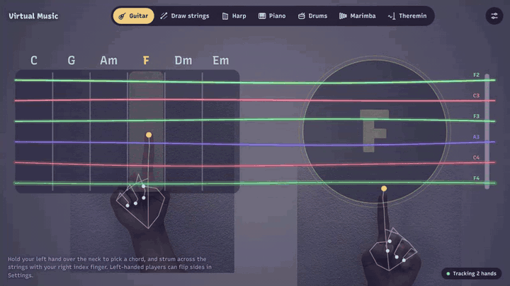
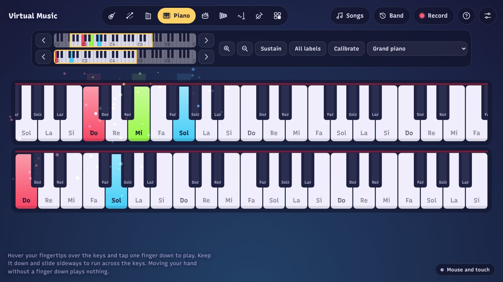
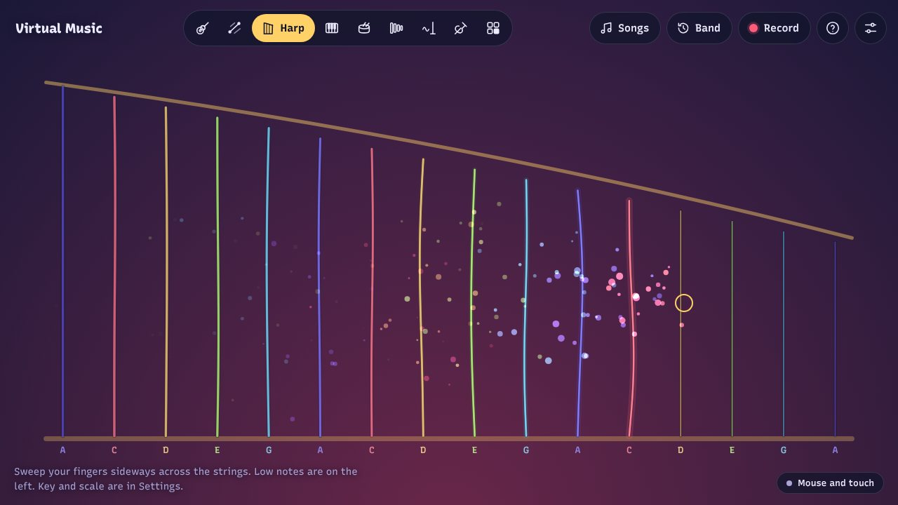
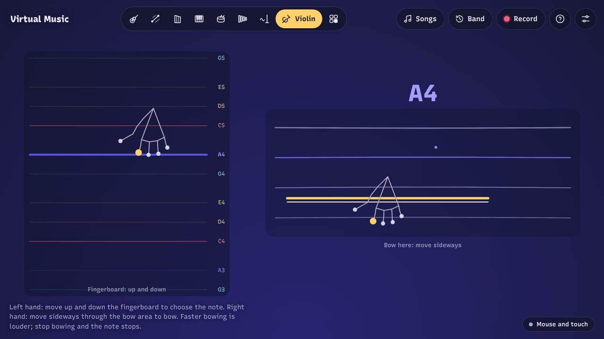
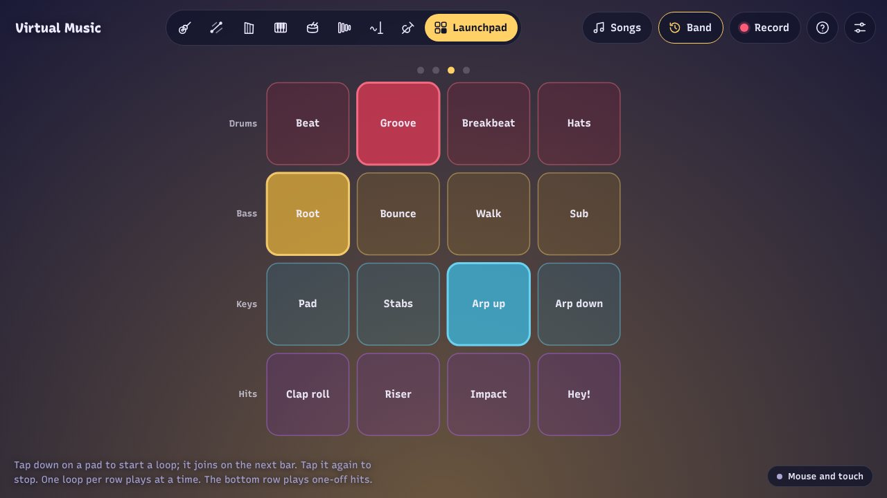
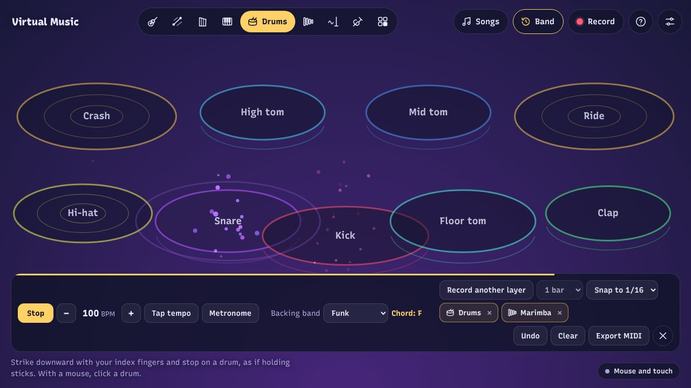
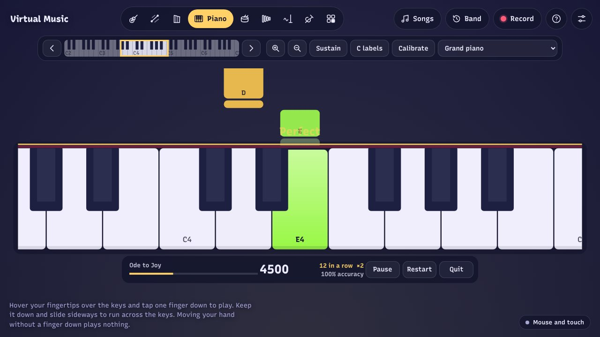
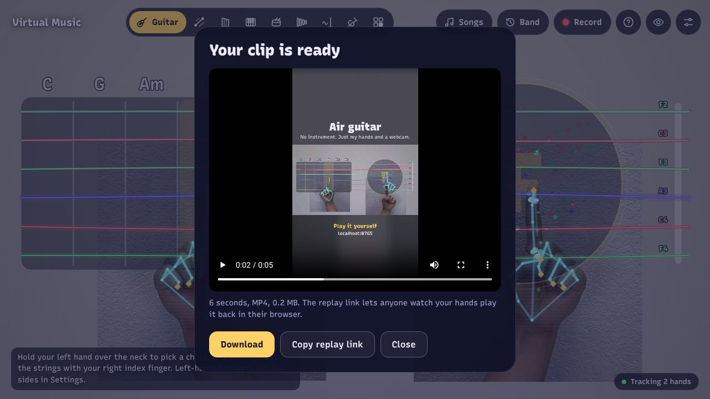
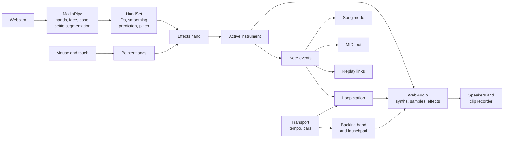

<div align="center">

# Virtual Music

**Play instruments in the air.**<br>
Your webcam tracks your hands. Guitar strings, piano keys and drums appear on screen, and you play them by moving your fingers. Then loop it, play along with a band, learn songs, and share a clip.

[Live demo](https://virtual-music.vercel.app/) · [Quick start](#quick-start) · [Instruments](#the-instruments) · [Band and loops](#band-loop-station-and-launchpad) · [Songs](#song-mode) · [Share](#record-and-share) · [How it works](#how-it-works)

[](LICENSE)
[](#quick-start)
[](https://ai.google.dev/edge/mediapipe/solutions/vision/hand_landmarker)
[](https://developer.mozilla.org/docs/Web/API/Web_Audio_API)
[](#contributing)



</div>

## Why

Short videos of people strumming virtual strings with hand tracking keep going viral, and they all stop at the demo. Virtual Music turns the idea into a whole band you can actually play: nine instruments, each with a gesture designed for how that instrument is really played. You strum the guitar, pluck the harp, tap piano keys, strike the drums, bow the violin and wave at the theremin. Then you can layer loops, jam over a backing band, learn songs with falling notes, and post a clip.

It all runs in a browser tab, with no install, no account and no server. Open the page, allow the camera, and play.

## Features

**Play**
- **Nine instruments:** guitar, draw-your-own strings, harp, a full piano, drums, marimba, theremin, violin (also viola and cello) and a launchpad of loops.
- **Real hand tracking in the browser:** Google's MediaPipe follows 21 points on each hand, up to 30 times a second, on your own computer. Two players can share the camera, four hands at once.
- **Gestures that feel like the real thing:**
  - The guitar has a chord neck and a strum zone, and the strings sound in the order you cross them.
  - Drums detect a stick-like strike.
  - The piano listens for individual finger taps, so moving your hand around never plays a note. Keep a finger down and slide to run across the keys.
  - The violin has a fingerboard for one hand and a bow area for the other. Faster bowing is louder.
- **A proper piano:** 49 to 88 keys with zoom and scroll, one or two keyboards, key labels (C4, C or Do-Re-Mi), sustain, note trails, recorded grand piano samples and 12 more sampled sounds.
- **Draw your own instrument:** pinch with both hands and pull to stretch a string anywhere. Its length sets its note.
- **Every note has a colour,** the same on every instrument, so a C is always red and a G is always blue.

**Make music**
- **Backing band:** drums, bass and chords in lo-fi, pop, rock, funk or bossa nova. On the guitar, the band follows the chord you hold.
- **Loop station:** record a few bars, switch instruments, and layer more on top. Notes snap to the beat. Export the loop as a MIDI file.
- **Launchpad:** start and stop drum, bass and keys loops that join on the next bar, plus one-shot hits.
- **Effects hand:** one hand plays while the other shapes the sound: raise it to open a filter, move it inward for echo, pinch for a reverb wash.
- **Song mode:** falling notes for 18 songs on piano, drums and guitar, with scores, stars, a learning mode that waits for you, slower speeds and a daily challenge.

**Show it off**
- **Record clips** with sound, as a vertical video for Reels, Shorts and TikTok or as landscape, and share them straight from the browser.
- **Replay links:** a short link that plays your performance back with ghost fingertips, then invites the viewer to try it. No video is uploaded; the notes are packed into the link itself.
- **Backgrounds:** cut yourself out of your room and play on a concert stage, a neon sunset, in space or in a studio, or just blur your room.
- **Hand styles and effects:** outline, light trails, hologram or fingertips only, with sparks, glow and an optional party mode that pulses with the music.

**Control it your way**
- **Face control:** open your mouth for a talk-box filter, raise your eyebrows to bend the pitch, smile for echo.
- **Body percussion:** nod your head or stomp a foot to play the kick drum while your hands play the rest.
- **MIDI out:** send everything you play to GarageBand, Ableton, a software synth or a hardware instrument.
- **Your own sounds:** put any sound file on a drum (or drop it onto the drum), or record your voice and play it across the piano.
- **Guided tutorials** for every instrument with a ghost hand that shows the move, and a piano calibration that measures your taps.
- **Hands-free buttons:** hold a fingertip over any button for a second to press it.
- **Works without a camera:** play with the mouse, a touch screen (multi-touch), or the computer keyboard.
- **Low latency options:** run tracking in a background thread and turn on motion prediction.

**Private and simple**
- Video never leaves your device, and nothing is uploaded or stored on a server.
- About 8,700 lines of plain JavaScript modules, with no framework, no bundler and no dependencies to install. Adding an instrument means writing one file.

## Gallery

<table>
  <tr>
    <td width="50%"><br><b>Guitar.</b> Pick a chord with one hand, strum with the other.</td>
    <td width="50%"><br><b>Draw strings.</b> Pinch with both hands and pull. Length sets the note.</td>
  </tr>
  <tr>
    <td><br><b>Piano.</b> Tap a finger to press a key. Rings fill up as a finger goes down.</td>
    <td><br><b>Two keyboards,</b> each scrolling on its own, here with Do-Re-Mi labels.</td>
  </tr>
  <tr>
    <td><br><b>Harp.</b> Sweep across the strings, tuned to any scale.</td>
    <td><br><b>Drums.</b> Strike down and stop, as if holding sticks.</td>
  </tr>
  <tr>
    <td><br><b>Marimba,</b> also vibraphone, glockenspiel and steel drum.</td>
    <td><br><b>Theremin.</b> Hand height is pitch; the other hand is volume.</td>
  </tr>
  <tr>
    <td><br><b>Violin.</b> One hand picks the note, the other bows.</td>
    <td><br><b>Launchpad.</b> Tap pads to start loops in time.</td>
  </tr>
  <tr>
    <td><br><b>Loop station.</b> Layer instruments over a backing band.</td>
    <td><br><b>Song mode.</b> Falling notes, scores and a daily challenge.</td>
  </tr>
  <tr>
    <td colspan="2" align="center"><br><b>Record and share.</b> A vertical clip ready for Reels, Shorts and TikTok, plus a replay link.</td>
  </tr>
</table>

## Quick start

**Try it online:** open the [live demo](https://virtual-music.vercel.app/) in Chrome, Edge, Safari or Firefox and choose **Turn on camera**.

**Run it locally.** Browsers only allow the camera and JavaScript modules on a web server, so serve the folder instead of opening `index.html` directly:

```bash
git clone https://github.com/khjabir/virtual-music.git
cd virtual-music
python3 -m http.server 8000     # or: npm start
```

Then open **<http://localhost:8000>**.

You need:
- a webcam;
- a recent desktop browser (Chrome or Edge give the smoothest tracking);
- an internet connection the first time. The hand-tracking model is about 20 MB, the grand piano samples about 8 MB, and each other piano sound under 1 MB. Backgrounds, face control and body percussion each load their own model (2 to 4 MB) the first time you turn them on. After that your browser serves them from its cache.

No webcam? Choose **Play with mouse or touch** on the start screen.

### Put it online

The app is a static site, so there is nothing to build, and every feature works on static hosting.

- **Vercel or Netlify:** import the repository and deploy with the default settings (no build command, output folder `/`).
- **GitHub Pages:** open **Settings → Pages**, choose **Deploy from a branch**, then pick `main` and `/ (root)`. After a minute it is live at `https://<your-username>.github.io/virtual-music/`.

All of these use HTTPS, which the camera requires.

## The instruments

| Key | Instrument | How to play |
| :-: | --- | --- |
| 1 | **Guitar** | Hold your left hand over the neck to pick one of six chords. Strum across the strings with your right index finger. Faster strums are louder, and a downstroke sounds the strings low to high. Four chord sets: pop, folk, rock and blues. Acoustic, nylon or overdriven electric. |
| 2 | **Draw strings** | Pinch thumb and index finger on **both** hands, then pull your hands apart to stretch a string between them. Let go to keep it. Longer strings play lower notes. Swipe across a string to pluck it. Pinching one hand never draws, so you can't draw by accident while playing. With a mouse, drag; on a touch screen, touch with two fingers. |
| 3 | **Harp** | 12 to 24 strings tuned to the current key and scale. Sweep your fingers sideways. |
| 4 | **Piano** | Hover your fingertips over the keys, then tap one finger down. Keep it down and slide to run across the keys. See [the piano](#the-piano) below. |
| 5 | **Drums** | Kick, snare, hi-hat, three toms, crash, ride and clap. Strike downward with your index fingers and stop on a drum. Harder strokes are louder. |
| 6 | **Marimba** | Strike the bars like the drums. Marimba, vibraphone, glockenspiel or steel drum. |
| 7 | **Theremin** | Your right hand's height sets the pitch and your left hand's height sets the volume. Pinch to go silent. Glide freely or snap to the scale. Raise your eyebrows to bend the pitch when face control is on. |
| 8 | **Violin** | Move your left hand up and down the fingerboard to choose the note, and move your right hand sideways through the bow area to bow. Faster bowing is louder; stop and the note stops. Also viola and cello. |
| 9 | **Launchpad** | Tap down on a pad to start a loop. It joins on the next bar, and one loop per row plays at a time. The bottom row plays one-off hits: clap roll, riser, impact and a shout. |

The harp, drawn strings, marimba, theremin, violin and backing band all follow the **Key** and **Scale** in Settings. The default is C major pentatonic, so nothing you play can sound wrong.

### The piano

**Playing with your hands.** Hold your hands over the keys as you would on a real piano: palms down, fingers relaxed. Then tap one finger down. A key plays only when a single finger moves down relative to its own knuckle. Moving your hands around, lowering them or tilting the whole hand plays nothing. Each fingertip over the keyboard shows a ring that fills as the finger goes down, and the key under it glows. Hold the finger down to hold the note, and faster taps play louder.

**Glissando.** Keep a finger down and slide sideways to run across the keys, as on a real piano. A slide that starts on a white key plays white keys, and one that starts on a black key plays black keys. If you'd rather lift a key whenever your finger slides off it, turn off **Slide a pressed finger to run across the keys** in Settings.

**Keyboard position.** By default the keyboard sits in the middle of the screen, so both hands fit in the camera view with your wrists visible. If that suits your camera better, choose **Higher up** or **Bottom of the screen** under **Keyboard position** in Settings.

**Zoom and scroll.** The strip at the top shows the whole keyboard, with the part on screen outlined in gold.
- **Scroll:** drag the strip, pinch it with your hand and slide sideways, or use the arrow buttons, the arrow keys or the mouse wheel.
- **Zoom:** from 7 white keys to the whole keyboard, using the magnifier buttons, the + and − keys, or Ctrl plus the wheel (or a trackpad pinch).

For hand play, zoom so each key is about as wide as the gap between your fingertips. Your zoom and position are remembered.

**Layouts.** One keyboard, or two stacked keyboards that each scroll on their own and can each have their own sound, such as bass below and electric piano above.

**Labels.** Off, C keys only, white keys or all keys, shown as C4, C or Do-Re-Mi.

**Sounds:**
- **Recorded:** the Salamander grand piano at two loudness levels (soft notes sound softer, not just quieter), bright piano, electric piano, FM electric piano, harpsichord, music box, vibraphone, jazz organ, church organ, strings, choir, warm pad and nylon guitar.
- **Built-in:** piano, electric piano, organ and synth, which work offline. If a recorded sound can't download, its built-in match plays instead.

**Sustain.** The Sustain button holds notes after you lift your fingers, like the right pedal. You can also hold the Space bar.

**Calibrate.** The Calibrate button measures how still your hand rests and how far your taps go, then sets the tap sensitivity to match.

**Other ways to play:**
- **Mouse or touch:** click or tap keys, slide along them, or use several fingers at once on a touch screen.
- **Computer keyboard:** A W S E D F T G Y H U J K O L P ; ' play from the first C on screen, and Z to M play the white keys an octave lower.

## Band, loop station and launchpad

Open **Band** in the top bar.

- **Tempo and metronome.** Set the tempo with − and +, or tap it in with **Tap tempo**.
- **Backing band.** Pick a style and the band starts: drums, bass and chords. On the guitar, the band plays whichever chord your left hand holds; on other instruments it follows a four-bar progression in the current key.
- **Loop station.** Choose a length (1, 2 or 4 bars) and press **Record a loop**. If nothing is playing you get a one-bar count-in. Play, and the loop starts repeating. Switch instruments and record another layer on top. Each layer shows as a chip: tap it to mute, or × to delete it. **Snap** moves notes onto the nearest 1/8 or 1/16. **Export MIDI** downloads the loop for any music app.
- **Launchpad** (key 9) adds ready-made drum, bass and keys loops that start on the next bar, so you can build a track without playing every part.

**Effects hand.** In Settings, under **Controls**, give one hand to the effects. That hand stops playing and becomes a mixer: its height opens a low-pass filter, moving it toward the middle adds echo (in time with the tempo), and a pinch adds a reverb wash.

## Song mode

Choose **Songs** in the top bar. Notes fall towards the piano keys or drums, or chords scroll towards the guitar's strum line, and each one is rated Perfect, Good, OK or Miss. Long runs multiply your score.

- **18 songs:** ten piano melodies (traditional or long out of copyright, from Twinkle Twinkle to Für Elise), four drum grooves and four guitar strumming charts.
- **Learning mode** on the piano waits for you to play each note before moving on.
- **Speed:** full, 75% or half speed.
- **Guide:** the tune plays quietly so you can follow it.
- **Today's challenge:** a different song every day, with your best score for the day.

Your best score and stars for every song are saved in your browser.

## Record and share

Press **Record** and choose:
- **Vertical clip:** 9:16 for Reels, Shorts and TikTok, with the stage in the middle and a title above it.
- **Landscape clip:** 16:9, exactly what you see.
- **Replay link only:** no video, just a link.

After a three-second countdown everything you see and hear is recorded, including the camera, background and effects. When you stop, you can watch the clip, download it (MP4 where the browser supports it, otherwise WebM), share it with your phone's share sheet, or copy a **replay link**. Whoever opens the link watches your performance played back by ghost fingertips, with the same instrument and settings, and then gets a "Your turn" prompt. The link holds the notes themselves, compressed, so no server is involved.

**Backgrounds.** In Settings, under **Camera and background**, choose a concert stage, a neon sunset, outer space, a cosy studio or a blurred room. MediaPipe's selfie segmentation cuts you out of the camera picture, and the scenes pulse with the music.

## More ways to play

- **Face control** (Settings, Controls): open your mouth to sweep a talk-box filter, raise your eyebrows to bend the pitch up to two semitones, and smile for echo.
- **Nod or stomp for the kick drum** (drum settings): your head or foot plays the kick while your hands stay on the snare and cymbals.
- **Two players** (Settings, Controls): track four hands, each player drawn in their own colour.
- **MIDI out** (Settings, MIDI): choose **Connect MIDI** and pick an output. Each instrument uses its own channel, with drums on channel 10. On a Mac, the built-in IAC Driver sends it to GarageBand or Logic.
- **Your own sounds** (Settings, Your own sounds): replace any drum with a sound file, or drag a file onto a drum. Record two seconds of your voice (or any sound), and play it across the piano by choosing **My recorded sound**. Sounds are kept in your browser.
- **Tutorials:** the first time you play an instrument with the camera, a short guide with a ghost hand shows you the moves. Open it again with the **?** button.

## Controls

| Action | How |
| --- | --- |
| Switch instrument | Keys **1** to **9**, click a tab, or hold a fingertip over a tab for a second |
| Open settings | **,** (comma) or the sliders button |
| Close a window, pause a song | **Esc** |
| Press any button hands-free | Hold your index fingertip over it until the gold ring fills |
| Draw strings: undo or clear | **Backspace** or **C** |
| Piano: play notes | **A W S E D F T G Y H U J K O L P ; '** (home row) and **Z X C V B N M** (an octave lower) |
| Piano: scroll and zoom | **← →** (hold **Shift** for an octave) and **+ −** |
| Piano: sustain pedal | Hold **Space** |

**Settings** are remembered in your browser. They are grouped into sound (volume, reverb, key and scale), camera and background, look (hand style and effects), controls (effects hand, face control, players, a **left-handed layout** that flips the guitar, drums, theremin and violin) and tracking, plus options for each instrument.

**Camera view and quality.** The eye button next to Settings switches the camera picture between **Clear** (full brightness, no shading), **Soft**, **Dimmed** (instruments stand out most) and **Hidden** (tracking keeps working). Under **Camera quality** you can choose 720p, 1080p (the default) or the highest your camera supports, up to 4K. Settings also shows what your camera is actually sending. The picture is drawn by the browser's own video layer at full resolution, and hand tracking uses a scaled-down copy, so a sharper picture doesn't slow tracking down.

**Latency.** Under **Tracking and latency**, **In the background** runs hand tracking in a separate thread so drawing and sound never wait for it, which helps most on slower computers. **Motion prediction** places your fingertips 15 or 30 ms ahead along their path, so strikes and strums land sooner.

### Tips for good tracking

- **Light your hands from the front.** A bright window behind you makes them hard to see.
- **Sit about an arm's length from the camera,** so each whole hand, including the wrist, stays in view.
- **A plain background helps.**
- **For the sharpest picture,** set Camera view to Clear and Camera quality to the highest. If your computer struggles, step back down to 1080p or 720p.
- **If tracking stutters on your computer,** set **Hand tracking runs** to *In the background*, or add `?cpu` to the address (`http://localhost:8000/?cpu`) to skip the GPU.
- **Backgrounds, face control and body percussion each add a model.** On a slow computer, turn on only the ones you use.

## How it works



1. **Tracking.** Each video frame goes to MediaPipe's hand landmarker, which runs on the GPU in WebAssembly and WebGL, either on the page or in a module worker. The 21 landmarks per hand are mirrored to match the selfie view and mapped onto the screen. A [One Euro filter](https://gery.casiez.net/1euro/) removes jitter when a hand is still but adds almost no lag to fast strums, and optional prediction extrapolates a few milliseconds ahead. Each hand keeps an ID between frames, so every fingertip knows where it was on the previous frame and how fast it is moving. Face blendshapes, pose and selfie segmentation run on the same frames only when their features are on.
2. **Gestures.** Each kind of instrument has its own detector:
   - **Plucking** (guitar, harp, drawn strings): each fingertip remembers which side of each string it is on, and a pluck is the moment that side flips. A fast swipe can't skip a string, a small dead zone stops a resting finger from re-triggering, and in a strum the strings sound in the order you crossed them, a few milliseconds apart.
   - **Striking** (drums, marimba, launchpad): a hit is a fast downward movement followed by a sudden stop, which is what a drumstick does. The speed of the stroke sets the loudness. Nods and stomps use the same idea on the nose and ankles.
   - **Finger taps** (piano): each fingertip is measured against its own knuckle, as a fraction of hand size, so moving the hand or changing its distance from the camera changes nothing. Tilting the whole hand is cancelled by comparing each finger with the least-moved of the other fingers. Each finger slowly learns its resting position, so any comfortable pose works.
   - **Bowing** (violin): the bow hand's sideways speed sets the loudness and brightness; the other hand's height picks the note, and held notes get a gentle automatic vibrato.
   - **Pinch** (drawing strings, grabbing the piano's scroll strip): the thumb and index tips come close, relative to hand size. A drawing pinch must be held briefly, and both hands must pinch.
3. **Note events.** Every instrument reports what it plays as small events (note on, note off, hit, continuous pitch). The loop station, song mode, tutorials, MIDI output, visual effects and replay links all listen to the same stream, and any instrument can play an event back. That is how loops and replays sound exactly like the original.
4. **Timing.** A look-ahead scheduler on the audio clock drives the metronome, loops, backing band and launchpad, so they stay in time even when the page is busy.
5. **Sound.** Everything is generated live with the Web Audio API:
   - **Plucked strings:** [Karplus-Strong](https://en.wikipedia.org/wiki/Karplus%E2%80%93Strong_string_synthesis) synthesis, rendered once per note and cached.
   - **Drums:** synthesized in the style of analogue drum machines.
   - **Marimba family:** modal synthesis with each bar's real overtone ratios.
   - **Theremin and bowed strings:** continuous voices with vibrato; the violin family adds body resonances.
   - **Piano:** recorded samples streamed on demand. They are spaced three semitones apart, so none is pitch-shifted more than one semitone.

   Everything passes through a shared effects chain (talk-box filter, low-pass filter, echo, reverb, limiter). Clips are recorded from the canvas and the same audio output with `MediaRecorder`.

### Project structure

```
virtual-music/
├── index.html                 page shell, panels and windows
├── styles.css                 all styling
├── src/
│   ├── main.js                camera, main loop, wiring
│   ├── core/bus.js            the note event stream
│   ├── tracking/              MediaPipe loader, hand tracker (page or worker),
│   │                          hand smoothing, face control, body percussion
│   ├── audio/                 engine and effects, synths, samples, transport,
│   │                          MIDI out and files, your own sounds
│   ├── instruments/           one file per instrument, plus base.js and common.js
│   ├── band/                  backing band styles, loop station, effects hand
│   ├── game/                  song mode and the song list
│   ├── video/                 backgrounds, clip recorder, replay links
│   └── ui/                    settings, panels, tutorials, hand drawing, effects
└── docs/images/               screenshots and demo
```

## Add your own instrument

Create a file in `src/instruments/`, extend `Instrument`, and add it to the list in `src/instruments/index.js`. It appears in the toolbar with its own number key, and gets a settings section built from its `settings` list. Here is a complete instrument, a row of pads you strike:

```js
import { Instrument } from './base.js';
import { StrikeDetector } from './common.js';
import { mallet } from '../audio/synths.js';

export class Pads extends Instrument {
  static id = 'pads';
  static label = 'Pads';
  static icon = '<rect x="4" y="4" width="16" height="16" rx="3"/>'; // SVG for the toolbar
  static hint = 'Strike a pad.';
  static settings = [{ key: 'kind', label: 'Sound', type: 'select', options: [['marimba', 'Marimba']], default: 'marimba' }];

  strikes = new StrikeDetector();

  layout() {        // on resize and when settings change
    this.pads = [60, 64, 67].map((midi, i) => ({ midi, x: this.W * (0.2 + i * 0.25), y: this.H * 0.5, r: 80 }));
  }

  update(hands) {   // every frame, with every tracked hand
    const at = (p) => this.pads.find((pad) => Math.hypot(p.x - pad.x, p.y - pad.y) < pad.r);
    for (const hit of this.strikes.detect(hands, [8], this.H, at)) {
      mallet(this.engine, this.channel, hit.zone.midi, { velocity: hit.velocity, kind: this.opts.kind });
      this.emit({ type: 'hit', key: hit.zone.midi, midi: hit.zone.midi, vel: hit.velocity, x: hit.zone.x, y: hit.zone.y });
    }
  }

  draw(ctx) {       // every frame
    for (const p of this.pads) { ctx.beginPath(); ctx.arc(p.x, p.y, p.r, 0, Math.PI * 2); ctx.strokeStyle = '#FFD166'; ctx.stroke(); }
  }
}
```

Each hand gives you:
- `points`: the 21 screen positions (4 is the thumb tip, 8 the index tip);
- `prev`: the same points on the last frame;
- `vel`, `pinching`, `pinchPoint` and `extended`.

For plucking, `CrossingDetector` in `common.js` does the work.

`this.emit()` reports a note to everything else: loops, song mode, MIDI, effects and replays. To make your instrument loopable and replayable, also implement `playEvent(evt, when)`, which plays an event without a hand.

## Browser support

| Browser | Status |
| --- | --- |
| Chrome and Edge (desktop) | Recommended. GPU hand tracking, lowest latency. |
| Safari 16.4+ and Firefox (desktop) | Supported. Tracking may fall back to the CPU and run slower. |
| Phones and tablets | Touch play works well. Camera play is possible but cramped. Sharing clips uses the phone's share sheet. |

The camera needs a secure page: `localhost` or HTTPS. Clip recording needs `MediaRecorder` (all current browsers). MIDI out needs Web MIDI (Chrome, Edge, Opera and Firefox).

## Privacy

The camera image is processed only inside your browser tab and is never uploaded or sent anywhere. Clips you record stay on your device until you download or share them yourself. Replay links contain only the notes you played and fingertip positions, never images. The microphone is used only while you record a sound for the piano. Settings, scores and your own sounds are saved in your browser's storage. The only network requests are for the app's own files: the MediaPipe library and models, fonts, and the piano samples.

## Troubleshooting

<details>
<summary><b>"Camera access is blocked"</b></summary>

Allow the camera for the site in your browser's address bar or site settings, then reload. On macOS, also check **System Settings → Privacy & Security → Camera** for your browser.
</details>

<details>
<summary><b>The page says it needs a local web server</b></summary>

You opened `index.html` straight from disk. Run `python3 -m http.server 8000` in the folder and open <http://localhost:8000>.
</details>

<details>
<summary><b>Hands aren't detected, or tracking is jumpy</b></summary>

Light your hands from the front, move back until your whole hand is in view, and avoid a bright window behind you. If it is still slow, try `?cpu` at the end of the address.
</details>

<details>
<summary><b>Piano taps don't register, or notes play by themselves</b></summary>

Adjust **Tap sensitivity** in Settings, and zoom so each key is about as wide as the gap between your fingertips. If your camera angle makes taps hard to see, switch **Press keys by** to *Lowering fingertips into the keys*.
</details>

<details>
<summary><b>No sound</b></summary>

Check the volume slider in Settings and your system volume. Browsers only start audio after a click, so make sure you chose one of the buttons on the start screen.
</details>

<details>
<summary><b>The clip has no sound, or won't play</b></summary>

Clips record the app's own sound, so make sure the volume slider isn't at zero. Some browsers only record WebM; if your phone or editor can't open it, try a different browser (Chrome and Safari can record MP4).
</details>

<details>
<summary><b>Connect MIDI finds no devices</b></summary>

Allow MIDI for the site when the browser asks. A Mac needs a MIDI destination: open Audio MIDI Setup, show the MIDI Studio, and turn on the IAC Driver. On Windows, install a virtual MIDI port such as loopMIDI.
</details>

<details>
<summary><b>"Could not download" next to a piano sound</b></summary>

The samples come from jsDelivr. Check your connection, or pick one of the built-in sounds, which work offline.
</details>

## Roadmap

Ideas, roughly in order. Contributions are very welcome.

- [x] Record and loop: layer a drum beat, chords and a melody
- [x] MIDI output (Web MIDI), to play any synth or DAW with your hands
- [x] Learn mode: falling notes for simple songs on the piano
- [x] A short calibration step that tunes thresholds to your camera and hands
- [x] Violin with a bow hand, and a launchpad
- [x] Clips, replay links, backgrounds and backing tracks
- [ ] Jam rooms: play together over WebRTC (needs a small signalling server)
- [ ] Online leaderboards for the daily challenge (needs a database)
- [ ] More instruments: DJ turntable, chord pad
- [ ] Installable offline app (PWA) with cached samples

## Contributing

Bug reports, ideas and pull requests are welcome.

1. Fork the repository and run it locally (see [Quick start](#quick-start)). There is nothing to install or build. Edit a file and reload.
2. Use **Play with mouse or touch** to test an instrument without a camera, and `window.virtualMusic` in the browser console to inspect the running app.
3. Keep to plain ES modules with no dependencies, and keep each instrument in its own file.
4. Open a pull request describing what you changed and how you tested it. A short screen recording helps a lot for gesture changes.

When reporting tracking problems, please mention your browser, your camera and roughly how far you sit from it.

## License

[MIT](LICENSE) © 2026 khjabir

Third-party assets keep their own licenses. They are loaded at runtime and not included in this repository:
- **Hand, face and pose tracking, segmentation:** [MediaPipe Tasks Vision](https://www.npmjs.com/package/@mediapipe/tasks-vision) and its models (Apache 2.0)
- **Grand piano samples:** [Salamander Grand Piano V3](https://archive.org/details/SalamanderGrandPianoV3) by Alexander Holm (CC BY 3.0), packaged as [@audio-samples/piano-mp3](https://github.com/darosh/samples-piano-mp3)
- **Other keyboard sounds:** the FluidR3 General MIDI sound font by Frank Wen (CC BY 3.0), via [gleitz/midi-js-soundfonts](https://github.com/gleitz/midi-js-soundfonts)
- **Typeface:** [Recursive](https://www.recursive.design/) (SIL Open Font License)

## Acknowledgements

- The many hand-tracked air-instrument videos that inspired this project.
- Google's MediaPipe team, for hand, face, pose and segmentation models that run in a browser tab.
- Kevin Karplus and Alex Strong, whose 1983 plucked-string algorithm still makes every guitar and harp string here.
- Géry Casiez, Nicolas Roussel and Daniel Vogel, for the One Euro filter.

<div align="center"><sub>Made with two hands and no instruments.</sub></div>
